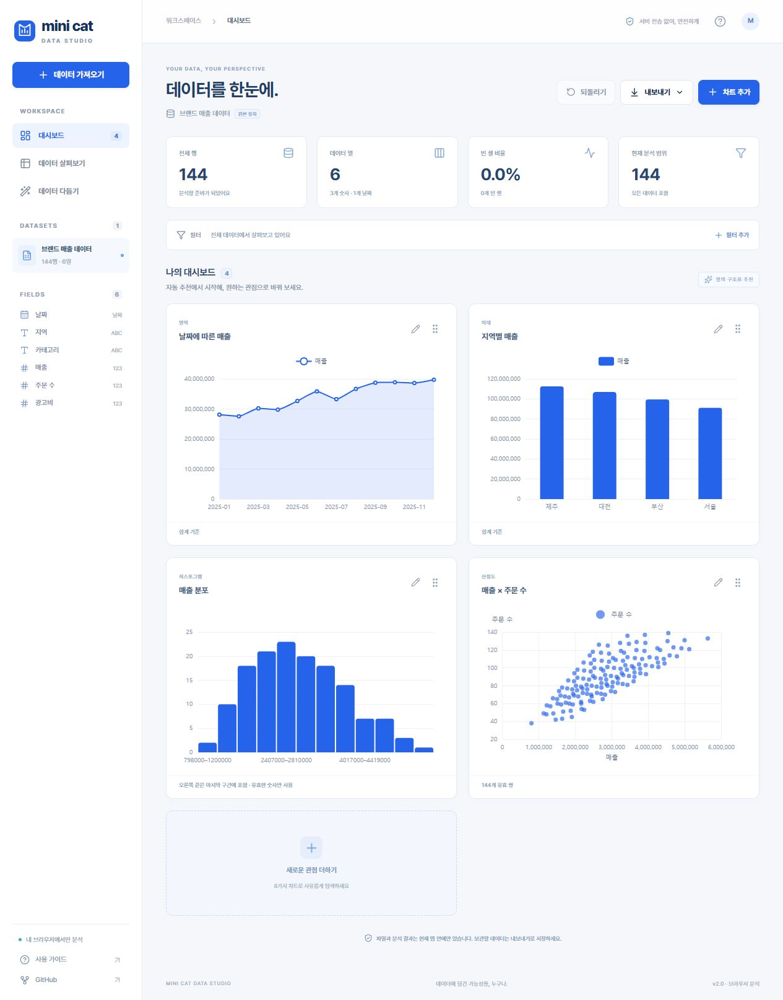

<div align="center">


# Mini Cat · Data Studio

**데이터를 올리면, 인사이트가 보입니다.**

파일 업로드부터 시각화와 전처리까지, 브라우저 하나로 시작하는 데이터 워크스페이스.

[웹에서 사용하기 ↗](https://dlwo8520.github.io/project1_mini_tableau/) · [사용 방법](#사용-방법) · [지원 형식](#지원-형식) · [로컬 실행](#로컬-실행) · [배포](#무료-배포) · [이전 버전](https://github.com/dlwo8520/project1_mini_tableau/tree/archive/pre-blue-redesign-20261019)

</div>



## 프로젝트의 시작

“데이터를 넣기만 하면 시각화와 전처리를 해주는 웹사이트가 있으면 좋겠다”는 생각에서 시작했습니다. 처음 만들 당시에는 Tableau의 존재를 알지 못했고, 직접 데이터를 탐색할 수 있는 도구를 만들어 보고 싶었습니다.

2026년 10월 개편에서는 이 목적에 집중해 기존 React·Django 구조를 **서버 없이 실행되는 데이터 스튜디오**로 다시 만들었습니다. 정해진 예시 결과를 보여주는 데모가 아니라, 방문자가 자신의 파일을 실제로 읽고 분석하는 웹앱입니다. Tableau와 연계된 제품은 아닙니다.

## 할 수 있는 일

| 흐름        | 기능                                                                                                   |
| ----------- | ------------------------------------------------------------------------------------------------------ |
| 가져오기    | 여러 파일, Excel 다중 시트, CSV 인코딩·구분자·소수점 설정, 머리글 유무 설정, JSON 배열 경로 지정       |
| 자동 탐색   | 열 자료형·빈 값·고유값·범위·평균 분석, 데이터 구조에 따른 차트 추천                                    |
| 시각화      | 막대, 선, 영역, 도넛, 산점도, 히스토그램, 상자 수염, Pearson 상관관계                                  |
| 차트 편집   | X·Y축, 합계·평균·중앙값·행 수·최솟값·최댓값, 색상 그룹, 날짜 묶기, 범주 수, 가로 막대, 값 표시, 팔레트 |
| 데이터 탐색 | 전체 차트에 적용되는 AND 필터, 테이블 검색·정렬·50행 단위 페이지                                       |
| 전처리      | 공백 정리, 중복 행 제거, 빈 값 행 제거·채우기, 자료형 변환, 열 이름 변경·삭제, 찾아 바꾸기, 계산 열    |
| 변경 확인   | 적용 전 처리 수·첫 5행 미리보기, 작업 기록, 되돌리기, 원본 복원                                        |
| 결과 저장   | 데이터 CSV·XLSX·JSON, 차트 PNG, 차트 집계 데이터 CSV                                                   |

샘플 3종은 **기능 체험용 가상 데이터**입니다. 실제 매출·환경 관측·설문 결과가 아닙니다. 자동 차트 추천은 열의 자료형과 고유값에 따른 규칙이며, 외부 AI API를 호출하지 않습니다.

### 자동 추천이 측정값을 고르는 방식

`Id`, `user_id`, `index`, `Unnamed: 0`, `순번` 등 식별자로 보이는 이름의 열은 자동 추천과 기본 상관행렬에서 제외합니다. 원본이나 자료형을 바꾸지는 않으며, 차트 편집에서 직접 선택하거나 상관행렬의 **ID 후보 열도 포함**을 켤 수 있습니다. 고유값이 많다는 이유만으로 일반 측정값을 제외하지 않습니다.

범주와 연속 측정값이 있는 데이터는 범주별 **행 수**와 측정값 **평균**을 우선합니다. 길이·너비·기온·점수는 평균, 매출·비용·수량 등 합산 가능한 이름의 열은 합계를 제안합니다. 이는 이름에 따른 추정이므로 원하는 분석과 다르면 차트 편집에서 바꾸세요. 작은 범주가 있으면 산점도 색상도 그 범주로 나눕니다.

예를 들어 `Id`가 있는 Iris CSV에서는 종별 ID 합계나 ID 분포를 추천하지 않습니다. 종별 개수(3개 막대), 종별 평균 측정값, 실제 측정값의 히스토그램, 종별 산점도를 제안합니다. 히스토그램은 데이터의 IQR과 행 수로 구간 수를 추정하고 읽기 쉬운 첫 화면을 위해 최대 12개로 제한합니다. IQR이 0이면 Sturges 규칙으로 대체합니다. 차트 편집의 **히스토그램 구간 수**에서 0(자동) 또는 1~50을 지정할 수 있으며, 구간 수와 관계없이 모든 유효한 값을 집계합니다. 계산법은 [NumPy가 설명하는 FD·Sturges 규칙](https://numpy.org/doc/stable/reference/generated/numpy.histogram_bin_edges.html)을 따르되 화면 요약을 위한 상한을 추가했습니다.

## 지원 형식

| 유형           | 확장자                                    | 처리 방식                                                           |
| -------------- | ----------------------------------------- | ------------------------------------------------------------------- |
| 구분자 텍스트  | `.csv`, `.tsv`, `.txt`                    | 쉼표·탭·세미콜론·파이프 자동 감지 또는 직접 선택                    |
| 스프레드시트   | `.xlsx`, `.xls`, `.xlsm`, `.xlsb`, `.ods` | 비어 있지 않은 모든 시트를 개별 데이터셋으로 가져오기               |
| 구조화 텍스트  | `.json`, `.jsonl`, `.ndjson`              | 레코드 배열·행 배열·열 단위 배열·배열을 담은 객체, 중첩 객체 펼치기 |
| 열 지향 데이터 | `.parquet`                                | Uncompressed, Snappy, Gzip, ZSTD, LZ4_RAW 등을 압축 해제하여 읽기   |
| 기존 표 데이터 | `.dbf`                                    | SheetJS 기반 표 읽기                                                |

UTF-8/BOM·UTF-16 BOM을 감지하고 UTF-8 실패 시 EUC-KR로 다시 읽습니다. EUC-KR/Windows-949, Shift JIS, GB18030, Windows-1252 등을 직접 선택할 수 있습니다. 인코딩 추정은 완벽하지 않으므로 글자가 깨지면 직접 설정하세요.

**파일당 50MB, 데이터셋당 10만 행·500열·200만 셀**까지 처리합니다. Excel 파일은 시트를 합쳐 200만 셀까지입니다. 이 수치는 처리 범위의 상한이며, 압축 해제 크기와 기기 메모리에 따라 작은 파일도 한도에 도달할 수 있습니다. 한도를 넘는 파일은 잘라서 분석하지 않고 오류를 표시합니다.

PDF·이미지 OCR, 데이터베이스 접속/덤프, 실시간 연결, 지리 지도, 파일 간 JOIN, 여러 사용자의 공동 편집은 현재 지원하지 않습니다. 이런 데이터는 먼저 지원하는 표 형식으로 변환하세요.

## 사용 방법

1. 파일을 화면에 놓거나 **데이터 가져오기**를 선택합니다. 가상 샘플로 시작해도 됩니다.
2. 자동 대시보드를 확인하고 각 차트의 편집 버튼으로 축·집계·그룹을 바꿉니다.
3. **필터 추가**로 분석 범위를 좁힙니다. 필터는 차트·테이블·내보내기에 적용되며 전처리에는 적용되지 않습니다.
4. **데이터 다듬기**에서 열 상태를 확인하고 작업을 미리 확인한 뒤 적용합니다.
5. 필요한 데이터를 내보내세요. 테이블 검색·정렬은 화면용이며 파일 내보내기에는 적용하지 않습니다.

계산 열은 `[매출] / [주문 수]`, `([매출] - [광고비]) / [매출]`처럼 작성합니다. 숫자, `[열 이름]`, `+ - * / ( )`만 지원하며 JavaScript를 실행하지 않습니다. 빈 값과 0으로 나눈 결과는 빈 값입니다.

## 데이터와 계산 원칙

- 파일은 **현재 탭의 메모리**에서 처리합니다. 업로드 서버, 로그인, 분석 추적 도구, 외부 AI API가 없습니다. 페이지 코드와 정적 자산은 호스팅 서비스에서 받아옵니다.
- 새로고침하거나 탭을 닫으면 데이터와 차트 설정이 사라집니다. 자동 저장하지 않으므로 먼저 내보내세요.
- `00123` 같은 앞자리 0이 있는 값과 안전한 정수 범위를 넘는 숫자 문자열은 텍스트로 보존합니다. 숫자처럼 보이는 값만 있는 열은 숫자로 추정합니다. 혼합 자료형 열은 텍스트로 남기며 직접 변환할 수 있습니다.
- 날짜는 검증 가능한 `YYYY-MM-DD` 계열과 ISO 날짜·시간만 추정하고 UTC로 묶습니다. 애매한 지역별 날짜 형식은 직접 정리해야 합니다.
- 중첩 JSON 객체의 키는 점 경로로 펼칩니다. 원래 키의 점·역슬래시는 이스케이프하고 배열은 JSON 텍스트로 보존합니다. 여러 배열 중 하나를 고르기 어려우면 JSON 경로를 요구합니다.
- 합계·평균·중앙값 등은 같은 범주의 **모든 유효한 숫자**를 집계합니다. 평균은 빈 값을 제외하고, 행 수는 빈 값이 있는 행도 셉니다. 없는 그룹의 값은 0으로 만들지 않습니다.
- 상관계수는 쌍별로 결측값을 제외합니다. 상수 열처럼 계산 불가능한 값은 `null`로 유지합니다. 상관계수는 인과관계를 뜻하지 않습니다.
- 상자 수염은 선형 보간 사분위수와 Tukey 1.5×IQR 기준입니다. 산점도는 화면에 약 5천 점을 간격 추출하고 전체 유효 쌍을 CSV로 내보냅니다. 상관행렬은 처음 18개 숫자 열, 색상 그룹은 최대 30개입니다.
- CSV에서 수식처럼 시작하는 **텍스트**에는 작은따옴표를 붙여 스프레드시트 수식 실행을 예방합니다. 원문 텍스트를 보존하려면 JSON을 선택하세요.
- Excel 수식은 저장된 계산 결과를 읽으며 재계산하지 않습니다. 암호화 파일은 지원하지 않습니다. 매크로는 실행하지 않습니다.
- JSON의 큰 정수는 원본부터 문자열이어야 정밀도가 보존됩니다. Parquet INT64는 문자열로 보존하며, DECIMAL은 JavaScript 숫자 정밀도, 시간은 밀리초 정밀도를 따릅니다. BSON·INTERVAL 등 일부 논리형은 지원하지 않습니다.

## 로컬 실행

Node.js **24 LTS**를 권장합니다. Vite 8은 Node 20.19+ 또는 22.12+가 필요합니다.

```bash
npm ci
npm run dev
```

```bash
npm test          # 데이터 처리·파일 호환성 검사
npm run build    # 타입 검사 + dist 빌드 + docs 복사
npm run preview  # 배포용 빌드 미리보기
```

PowerShell 실행 정책으로 `npm`이 차단되면 `npm.cmd`를 사용하세요. SheetJS CE는 오래된 npm `xlsx` 대신 [공식 0.20.3 배포본](https://docs.sheetjs.com/docs/getting-started/installation/nodejs/)을 고정 사용합니다. 파서는 빌드에 포함되므로 사용자가 파일을 읽을 때 CDN에 요청하지 않습니다.

## 구조

```text
src/
  App.tsx          화면·데이터셋·대시보드 상태
  Dialogs.tsx      가져오기·차트·필터·전처리 폼
  ChartCard.tsx    필요할 때 불러오는 ECharts 렌더러
  data.worker.ts  데이터를 보관하고 요청을 순서대로 처리하는 Worker
  importers.ts    파일별 파싱·표 정규화
  engine.ts       자료형·프로필·필터·집계·통계·전처리
  client.ts       Worker 통신·다운로드
  samples.ts      공개 가능한 가상 샘플
  types.ts        공통 타입
  style.css       파란색 반응형 UI
tests/            순수 엔진과 실제 포맷 호환성 검사
scripts/          GitHub Pages 산출물 생성·처리 벤치마크
public/           정적 아이콘
docs/             GitHub Pages용 빌드 (자동 생성)
media/            실제 앱 화면
```

파싱·프로필·집계·전처리는 Web Worker에서 실행합니다. Worker는 원본과 현재 데이터, 작업 목록을 보관하고 화면에는 프로필·페이지·차트 결과를 보냅니다. 차트·Excel·Parquet 모듈은 필요할 때 불러옵니다. 가상환경, SQLite DB, 실행되지 않는 이전 프로토타입은 현재 소스에서 제외했으며 Git 이력과 보관 브랜치에 남아 있습니다.

## 무료 배포

이 저장소의 `docs/`에는 상대 경로로 빌드한 결과가 포함되어 있습니다.

1. GitHub 저장소 **Settings → Pages**를 엽니다.
2. Source: **Deploy from a branch**
3. Branch: **main**, 폴더: **/docs**를 고르고 Save를 누릅니다.
4. 배포가 성공하면 `https://dlwo8520.github.io/project1_mini_tableau/`에서 사용할 수 있습니다.

업데이트할 때는 `npm run build` 후 소스와 `docs/`를 함께 커밋하세요. `.nojekyll`도 자동 생성됩니다. 다른 무료 정적 호스팅에는 `dist/`를 배포할 수 있습니다. 서버 비용이나 상시 켜진 PC가 필요 없습니다.

## 검증

숫자·앞자리 0·큰 정수 문자열, 엄격한 날짜, 중복 머리글, 그룹 집계, 결측값·상수 분포·상관계수, 필터, 안전한 수식, 전처리 원본 보존, JSON 경로 충돌, CSV escaping, 실제 CSV·한글 EUC-KR·UTF-16 TSV·다중 시트 XLSX/XLS/XLSM/XLSB/ODS·DBF, Parquet Uncompressed/Snappy/ZSTD/Gzip/LZ4_RAW를 검사합니다.

실제 브라우저에서는 파일 선택 → 업로드 → 자동 차트 → 필터 → 전처리 미리 확인·적용·되돌리기 → 테이블 검색·정렬 → CSV 다운로드를 확인했습니다. 모바일에서도 차트를 한 열로 배치하고 메뉴를 접을 수 있습니다.

`npx tsx scripts/benchmark.ts`로 10만 행·60만 셀의 프로필·자동 차트·중복 제거 비용을 측정할 수 있습니다. 이는 Node에서 실행되는 엔진 측정이며 브라우저 기기별 속도를 보장하지 않습니다.

## 사용한 오픈소스

[React](https://react.dev/) · [Vite](https://vite.dev/) · [Apache ECharts](https://echarts.apache.org/) · [Lucide](https://lucide.dev/) · [PapaParse](https://www.papaparse.com/) · [SheetJS CE](https://sheetjs.com/) · [hyparquet](https://github.com/hyparam/hyparquet) · [hyparquet-compressors](https://github.com/hyparam/hyparquet-compressors)

각 패키지의 라이선스는 해당 프로젝트에 귀속됩니다. Parquet 테스트 파일은 [apache/parquet-testing](https://github.com/apache/parquet-testing)의 Apache-2.0 자료이며 `tests/fixtures/LICENSE`를 포함합니다.
